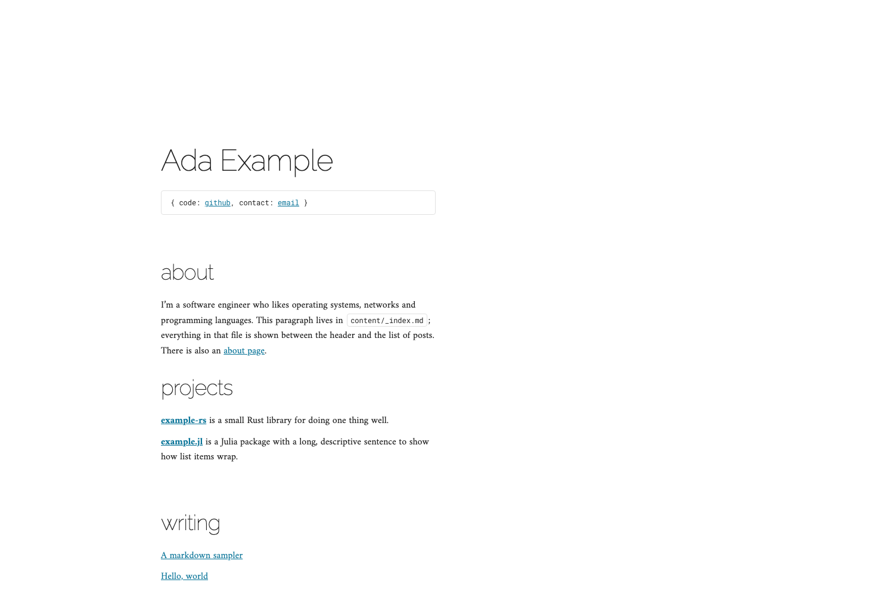

# meh

[](https://github.com/saurvs/meh-theme/actions/workflows/ci.yml)

A minimal, monospace-flavoured personal homepage and blog theme for
[Hugo](https://gohugo.io/), built on [Skeleton](https://github.com/dhg/Skeleton).



The home page shows your name, a `{ code: github, contact: email }` line, the
contents of `content/_index.md` (about, projects, anything else) and a list of
your posts. Posts and other pages get a single narrow column with a
`posted on <date> by <name>` footer.

## Requirements

Hugo **0.158.0 or later** (the standard edition is enough; the theme uses no
Sass). CI builds the example site with 0.158.0 and with the latest Hugo
release, and fails on any warning or deprecation notice.

## Installation

As a Git submodule:

```sh
git submodule add https://github.com/saurvs/meh-theme.git themes/meh-theme
```

Then set `theme = "meh-theme"` in your `hugo.toml`. (Or clone it into
`themes/meh-theme` without a submodule.)

## Configuration

```toml
baseURL = "https://example.org/"
title = "Ada Example"
locale = "en-US"          # used for <html lang>
theme = "meh-theme"

[params]
  description = "Used for <meta name=description> when a page has none."
  writingHeading = "writing"        # heading of the post list on the home page
  dateFormat = "Jan 2, 2006"        # Go time layout for post dates
  disableGoogleFonts = false        # true: use system fonts, no requests to Google
  themeColor = "#252525"            # <meta name=theme-color>
  notFoundText = "There is nothing here."   # text of the 404 page
  footerCode = '''
optional preformatted text shown below the post list
'''

  [params.author]
    name = "Ada Example"            # post footers ("by ..."); defaults to the site title
    email = "ada@example.org"       # "contact: email" link on the home page
    github = "example"              # "code: github" link on the home page

[pagination]
  pagerSize = 10                    # posts per page on section list pages

# Optional: a light highlighting style that meets WCAG AA contrast on white.
[markup.highlight]
  style = "github"
```

### Content

- `content/_index.md`: the body is shown on the home page, between the header
  and the list of posts. Use `##` headings (`## about`, `## projects`).
- `content/post/*.md`: posts. The home page lists the regular pages of the
  site's [main sections](https://gohugo.io/configuration/all/#mainsections)
  (by default the section with the most pages), newest first.
- Other pages (for example `content/page/about.md`) are rendered with the same
  single-column layout. Pages without a `date` leave it out of their footer.

### Extra `<head>` content

Create `layouts/_partials/head-extra.html` in your site to add anything to
`<head>` (analytics, a favicon, extra CSS). The theme includes it if it exists.

## Example site and screenshots

```sh
git clone https://github.com/saurvs/meh-theme.git
cd meh-theme/exampleSite
hugo server --themesDir ../..
```

`images/screenshot.png` (1500×1000) and `images/tn.png` (900×600) are
screenshots of the example site's home page at a 1500×1000 viewport in
headless Chromium. To update them, build the example site, take a new
1500×1000 screenshot and scale it to 900×600 for `tn.png`.

## Upgrading from the 2017 version

The theme was rewritten for current Hugo (see [CHANGELOG.md](CHANGELOG.md)).
To move an existing site over:

- Move `[author]` to `[params.author]` (Hugo removed `.Site.Author`).
- Replace `languageCode = "en-us"` with `locale = "en-US"` (Hugo 0.158.0
  deprecated `languageCode`).
- The about and projects text used to be hard-coded in the theme's
  `layouts/index.html`. Put it in `content/_index.md` instead.
- If you used `paginate = N`, use `[pagination] pagerSize = N`.

## Accessibility

The example site has no [axe-core](https://github.com/dequelabs/axe-core)
WCAG 2.1 AA or best-practice violations in Chromium and WebKit, at desktop and
phone widths. The theme sets `<html lang>` from `locale`, includes the viewport
meta tag, uses one `<h1>` per page with no skipped heading levels, wraps content
in a `<main>` landmark, uses link colours with at least 4.5:1 contrast, and
keeps long code blocks scrollable inside the column. Give every image alt text
in your Markdown (``).

## Credits

- [Skeleton](https://github.com/dhg/Skeleton) 2.0.4 by Dave Gamache (MIT), with local
  font and list-style changes, in `static/css/skeleton.css`.
- [normalize.css](https://necolas.github.io/normalize.css/) (MIT) in
  `static/css/normalize.css`.
- Fonts: Amiri, Raleway and Roboto Mono, loaded from Google Fonts unless
  `disableGoogleFonts` is set.

## License

The theme's own templates and CSS have no license yet. Skeleton and
normalize.css are MIT-licensed, as noted in their files.
